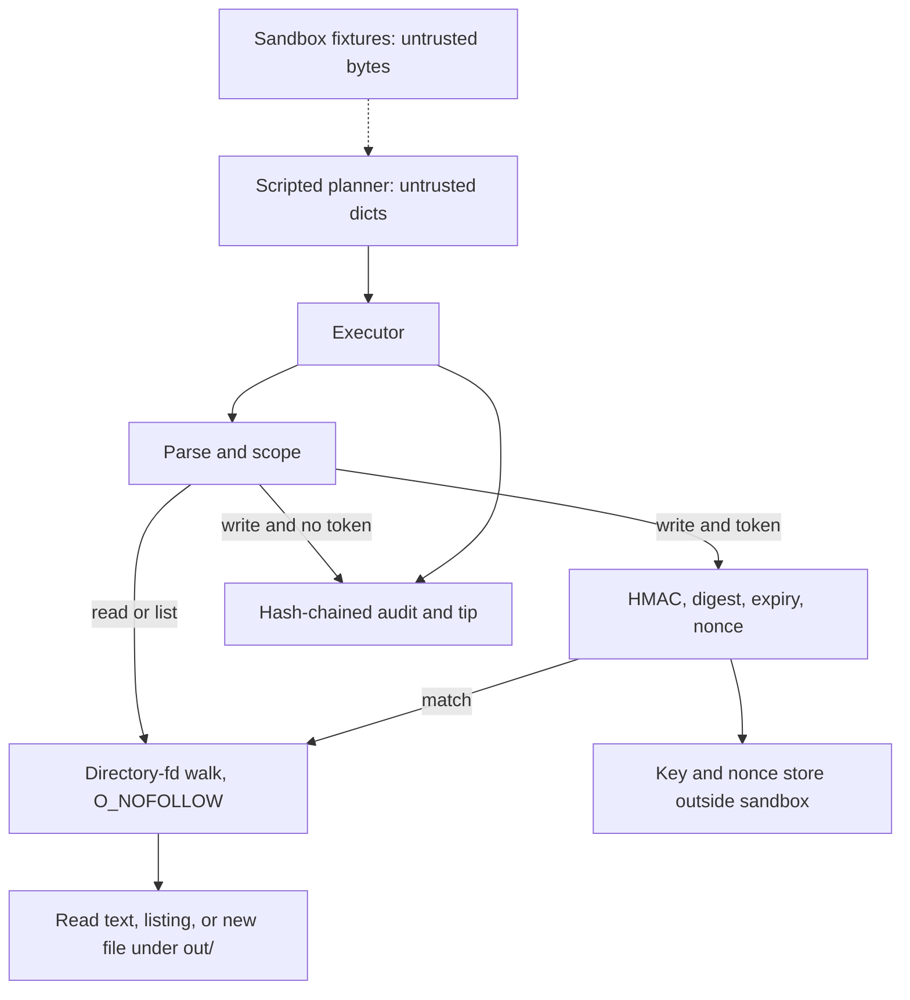

# Architecture

> **Draft.** The docs were fact-checked on 10 Nov 2026. There has been no independent third-party security review. This is the structure of the lab, not a deployment design.

## Components

| Module | Role | Trust |
| --- | --- | --- |
| `planner.py` | Returns handwritten action dicts, including a sequence that imitates following `inbox/message.txt`. | Untrusted input |
| `fixtures/` | Synthetic files copied into `sandbox/`. | Untrusted bytes |
| `policy.py` | Parses the dict and applies scope. Does not open files and does not import the planner. | Trusted |
| `approval.py` | Issues and checks HMAC tokens. `authorize` consumes the nonce. `verify_token` does not. | Trusted |
| `fs.py` | Walks from the sandbox directory fd. | Trusted, and not a sandbox by itself |
| `executor.py` | Runs the steps in order. Approval text inside the action is not read as a token. | Trusted |
| `audit.py` | Appends a metadata record and a tip hash. | Trusted |
| `demo_runner.py` | Trusted glue. Calls `issue_token` once for the scripted human step. | Trusted |
| `cli.py` | Operator interface. `--confirm` signs. Stdout receives the token, not the sandbox. | Trusted |

The executor does not import the planner. The policy module does not import the walker. The walker does not know about approvals. Those import edges are tested.

## Flow

```text
 planner dict                         operator key (mode 0600)
      |                                      |
      v                                      v
 Executor.execute(raw, approval_token, now)
      |
      |  1. parse schema and path syntax
      |  2. scope: reads inbox|notes, lists inbox|notes|out,
      |     writes only out/<name>
      |  3. non-writes: reject a token if one was passed, then read or list
      |     writes without a token: needs_approval, no create
      |     writes with a token: HMAC, canonical body, exact digest,
      |     lifetime, clock, then consume nonce
      |  4. openat + O_NOFOLLOW (+ O_EXCL for create)
      |  5. append the audit record
      v
 result returned to the caller
 file created only after step 3 succeeds for a write
```



## Workspace

```text
workspace/
  sandbox/                 tool tree, pinned by a directory fd
    inbox/                 readable, listable; fixtures and escape links
    notes/                 readable, listable
    private/               inside the directory, denied by scope
    out/                   listable; create-only writes of one path segment
  outside/                 symlink and hard-link target, not a tool root
  operator/                approval.key, nonces.txt  (directory mode 0700)
  audit/audit.jsonl       metadata log
  audit/audit.jsonl.tip   last record hash
```

`prepare_workspace` copies regular fixture files, then creates the symlink and the hard link with `os.symlink` and `os.link`. It refuses a workspace path whose resolved parent is `/`, and it refuses a symlink workspace path. Replacing an existing workspace uses `shutil.rmtree`. A regression test checks that a symlink pointing at a directory outside the workspace is not followed during that wipe.

## Approval binding

The signed body is canonical JSON with keys sorted and no extra whitespace:

```text
{"digest","exp","iat","nonce","v"}
```

`digest` is SHA-256 of another canonical object: version, capability, path, content SHA-256, and content length. Reads use an empty content hash and length 0. Any change to the path or the UTF-8 bytes changes the digest. The executor recomputes the digest from the action it is about to run. It does not accept a digest supplied by the planner.

Default CLI lifetime is 300 seconds. The verifier rejects a lifetime longer than 3600 seconds even if the HMAC is valid. The demo uses a fixed integer clock so its audit tip is stable. The CLI uses the local clock.

The demo's call to `issue_token` is the stand-in for a person who has read the binding. The library will happily sign whatever action it is given; the CLI signs only after `vet` and only for `write_file`. The executor still vets again and will refuse a token that tries to widen scope.

## Filesystem walk

`Sandbox` opens the root with `O_DIRECTORY|O_NOFOLLOW` and keeps that fd. It records that fd's Linux mount id. Child opens pass `dir_fd` and `O_NOFOLLOW`. After open, `fstat` requires the same device, and the mount id must match the root. A same-filesystem bind mount fails that check. Regular files must also have `st_nlink == 1`. Non-regular files are rejected with `lstat` before they are opened. Listings classify a symlink without calling `readlink`.

Writes create the final name with `O_CREAT|O_EXCL|O_NOFOLLOW` and mode `0644` with the execute bits cleared if any are present. The file is unlinked if a later step in that create raises. This is still not a strong OS sandbox: same OS user, no mount namespace, no user namespace, no seccomp. See the TOCTOU section of [THREAT_MODEL.md](../THREAT_MODEL.md).

`read_file` does not serve `out/`. The planner already had the bytes it proposed. The lab does not echo them back as a tool result. `list_dir` can show the name.

## Audit

Records are one canonical JSON object per line. The hash covers every field except `hash`, including `prev`. The tip file is replaced after the line is synced. `verify` recomputes the chain and compares the tip.

The record cannot carry a `content` or `token` field: the field set is exact, and a bad event fails the append. If the append fails after a create, the executor unlinks that regular file and returns `audit_failed`. A crash before that unlink can leave the file. A full rewrite of the log and the tip still verifies; there is no external witness.

## What is intentionally absent

- A model client, including a local Ollama adapter. Adding one would put a download or a daemon on the default path.
- Shell, network, and mail tools.
- A mutable approval file inside the sandbox.
- An external log witness, a second person, and a rate limit.
- A separate uid or a kernel sandbox. Those would change the claim this process can make, and they are not implemented.
