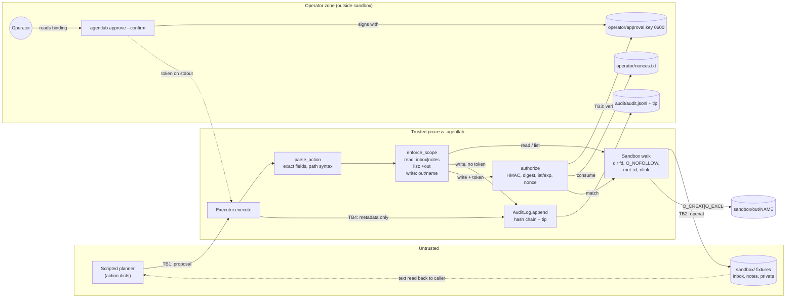

# STRIDE threat model

> **Draft, 17 Nov 2026.** Written by the lab's author and fact-checked on 17 Nov 2026 against commit [`96d816a`](https://github.com/mikedsosa/agent-boundary-lab/commit/96d816a8781b067b2d35dbbe05621db4b02c1a8b), which includes the S4 preview fix. There has been no independent third-party security review. It is not an audit report and not a claim of compliance with any standard.

This is the structured companion to [THREAT_MODEL.md](../THREAT_MODEL.md), which has the longer prose on enforcement, TOCTOU, and the OWASP pages. This file walks the same system with STRIDE (Spoofing, Tampering, Repudiation, Information disclosure, Denial of service, Elevation of privilege), names the trust boundaries, and maps each threat to the control in the code and the test that exercises it. Where no test exists, it says so.

## 1. Scope

In scope: one Linux process running `agentlab` (CLI or library), the workspace that `prepare_workspace` creates, the operator who runs `approve --confirm`, and the scripted planner.

Not in scope: a real model or prompt, any network or shell tool (none exist), other programs running as the same OS user, kernel or container escapes, and a hostile operator who already holds the approval key. These are the same exclusions as THREAT_MODEL.md.

## 2. Assets

| ID | Asset | Why it matters |
| --- | --- | --- |
| A1 | Bytes outside the capability scope: `sandbox/private/`, `outside/`, anything else on disk | Confidentiality. A read that returns them is a breach of the boundary. |
| A2 | `sandbox/out/` | Integrity. A file should appear only for the exact approved bytes, once, and never replace an existing name. |
| A3 | `operator/approval.key` (32 random bytes, mode `0600`) | Whoever holds it can approve any in-scope write. |
| A4 | `operator/nonces.txt` | The single-use property of approvals depends on it. |
| A5 | `audit/audit.jsonl` and `audit/audit.jsonl.tip` | The record of what was allowed and denied. Must not contain file bodies, tokens, or the key. |
| A6 | The operator's review of the binding | The human decision is the only thing that turns a staged write into an effect. |

## 3. Actors and trust levels

| Actor | Trust | Notes |
| --- | --- | --- |
| Planner (`planner.py`) | Untrusted | Handwritten dicts that stand in for model output, including a sequence that "obeys" injected text. |
| Fixture bytes under `sandbox/` | Untrusted | Synthetic. Includes an injection message, a fake secret-shaped token in `private/`, escape symlinks, and a hard link. |
| Executor, policy, approval, fs walker, audit | Trusted | Python code and interpreter are assumed intact. |
| Operator | Trusted, but fallible | Holds the key through the CLI and is expected to read the printed binding. |
| Other processes as the same OS user | Out of scope | Can read and write everything the lab can. Stated, not mitigated. |

## 4. Trust boundaries

- **TB1, planner to executor.** Every proposal crosses `Executor.execute(raw, ...)`. Nothing the planner returns is executed without parse, scope, and (for writes) approval.
- **TB2, executor to filesystem.** The walk opens only from the pinned sandbox directory fd with `O_NOFOLLOW`, checks device and Linux mount id, and requires `st_nlink == 1` for regular files.
- **TB3, operator to approval.** The only way to mint a token is the key. The CLI signs only after `vet` and only for `write_file`, and only with `--confirm`. Text in an action or a fixture is never read as a token.
- **TB4, executor to audit and operator stores.** `operator/` and `audit/` are siblings of `sandbox/`, not tool roots. No capability can name them.
- **TB5, process to the rest of the OS user's session.** Not enforced. This is where the lab stops being a sandbox.

## 5. Data-flow diagram



The dotted edge from fixtures back to the planner is the indirect prompt-injection path. In this lab the script does not consume that text as instructions, but a real integration would, and the boundary would only see the next proposal.

## 6. STRIDE analysis

Status key: **Mitigated** means the control exists and a listed test exercises it. **Partial** means a control exists but has a stated gap. **Accepted** means the lab does not address it and says so. **Finding** means this review found it and it is not yet documented or fixed elsewhere.

### Spoofing

| ID | Threat | Control in code | Tests | Status |
| --- | --- | --- | --- | --- |
| S1 | Fixture or action text claims to be an approval (`APPROVED`, a pasted token) | The token is a separate `approval_token` argument; action dicts have an exact field set, so an extra `approval` key is `malformed` | `test_boundary.py::test_untrusted_fixture_text_does_not_authorize`, `test_boundary.py::test_approval_text_is_not_an_approval`, `test_policy.py::test_malformed_actions_are_rejected` | Mitigated |
| S2 | Forged token (wrong key, edited body) | HMAC-SHA256 checked before digest; canonical body required; extra fields rejected | `test_boundary.py::test_bad_signature_and_extra_fields_are_rejected`; demo row `summary_forged` | Mitigated |
| S3 | Unicode lookalike path or content passes as the approved action | Digest covers the exact UTF-8 bytes and canonical path | `test_boundary.py::test_unicode_lookalikes_are_different_actions` | Mitigated |
| S4 | Approval preview spoofing: `write_file` content containing a carriage return or ANSI escape sequence rewrites what the operator sees on stderr during `approve` | `_preview` escapes `\n`, `\r`, `\t`, backslashes, and every other C0, DEL, and C1 control (ESC as `\x1b`). Truncation is at 120 characters of escaped output and does not split an escape sequence. `content_len`, `content_sha256`, and `digest` are still printed | `test_cli.py::test_preview_escapes_c0_c1_and_named_controls`, `test_cli.py::test_preview_truncates_on_escape_boundaries`, `test_cli.py::test_cli_approve_preview_does_not_emit_raw_control_characters` | **Mitigated** (fixed in [`96d816a`](https://github.com/mikedsosa/agent-boundary-lab/commit/96d816a8781b067b2d35dbbe05621db4b02c1a8b); see section 8) |

### Tampering

| ID | Threat | Control in code | Tests | Status |
| --- | --- | --- | --- | --- |
| T1 | Signed write is edited by one byte or one path segment | Executor recomputes the digest from the action it is about to run; mismatch does not consume the nonce | `test_boundary.py::test_changed_bytes_or_path_do_not_match_and_do_not_consume`; demo row `summary_tampered` | Mitigated |
| T2 | Write follows a planted symlink or clobbers an existing file | `O_CREAT|O_EXCL|O_NOFOLLOW`; symlinked `out/` not entered | `test_boundary.py::test_symlink_destination_is_not_replaced`, `test_boundary.py::test_symlinked_out_directory_is_not_followed`, `test_boundary.py::test_existing_file_is_not_clobbered` | Mitigated |
| T3 | Partial file left after a failed write or failed audit | `Sandbox.create_file` unlinks the new file if the write fails; the executor removes it if the allow record cannot be audited (`audit_failed`) | `test_boundary.py::test_failed_write_unlinks_the_new_file`, `test_audit.py::test_audit_failure_does_not_leave_the_new_file`, `test_audit.py::test_audit_rollback_failure_is_reported` | Partial: a crash between create and unlink can leave a file |
| T4 | Audit lines edited or dropped | Hash chain plus tip file; `verify-audit` recomputes | `test_audit.py::test_chain_detects_edits_and_truncation` | Partial: a full rewrite of log and tip verifies (`test_audit.py::test_rewritten_chain_and_tip_verify_locally`). No external witness |
| T5 | Approval key replaced or loosened | Key path must not be a symlink, must have no group or world permission bits (it is created 0600), must be exactly 32 bytes, and sits outside the sandbox; no capability can write it | `test_boundary.py::test_loose_or_symlinked_key_is_refused`, `test_boundary.py::test_control_paths_are_not_tool_targets` | Mitigated against tools; Accepted against the same OS user |
| T6 | File swapped between check and open (TOCTOU) | String checks before any open, `O_NOFOLLOW`, `fstat` on the opened fd, mount id compare | `test_boundary.py::test_traversal_absolute_and_hardlink_do_not_escape`, `test_mounts.py::test_cross_device_and_bind_mounts_are_denied` | Partial: regular file to FIFO swap between `lstat` and `open`, and hard-link count returning to 1, are documented gaps |

### Repudiation

| ID | Threat | Control in code | Tests | Status |
| --- | --- | --- | --- | --- |
| R1 | An allowed or denied action leaves no record | Every `execute` outcome, including denials, is appended; an allow whose audit append fails is rolled back | `test_audit.py::test_demo_audit_verifies_and_omits_fixture_bodies`, `test_audit.py::test_audit_failure_does_not_leave_the_new_file` | Mitigated |
| R2 | Operator denies having approved a write | Audit records time, capability, path, content hash, and length. It does not record who approved, the token, or the nonce | None | Accepted: single-operator lab, no identity |
| R3 | Audit rewritten by someone with write access to `audit/` | Local chain only | `test_audit.py::test_rewritten_chain_and_tip_verify_locally` (shows the limit) | Accepted |

### Information disclosure

| ID | Threat | Control in code | Tests | Status |
| --- | --- | --- | --- | --- |
| I1 | Read of `private/`, traversal, absolute path, symlink, hard link, bind mount | Scope allowlist independent of the walker; dir-fd walk with `O_NOFOLLOW`, `st_nlink == 1`, device and mount id checks | `test_boundary.py::test_private_file_is_inside_the_tree_but_denied`, `test_boundary.py::test_os_user_can_follow_symlink_and_the_boundary_does_not`, `test_boundary.py::test_traversal_absolute_and_hardlink_do_not_escape`, `test_mounts.py`; `test_policy.py::test_scope_is_narrower_than_a_path_that_parses` | Mitigated within the process |
| I2 | Denial reveals whether a private file exists | `private/` paths are `scope_denied` before any open | `test_boundary.py::test_private_file_is_inside_the_tree_but_denied` | Mitigated |
| I3 | Listing reveals symlink targets | Listings classify without `readlink` | `test_boundary.py::test_list_hides_symlink_targets` | Mitigated |
| I4 | Audit, demo output, or errors copy file bodies, tokens, or the key | Fixed audit field set; the demo prints the text of two benign in-scope fixtures (`notes/schedule.txt`, `inbox/status.txt`) and only lengths, digests, and hashes for everything else; it never prints the injection message, the synthetic token, the key, or an approval token | `test_boundary.py::test_write_error_audit_has_no_secret_marker`, `test_demo.py::test_demo_is_deterministic_and_hides_untrusted_bodies`, `test_cli.py::test_cli_approve_requires_confirm_and_does_not_write_the_token` | Mitigated |
| I5 | Approval token exposed through `execute --approval-token <token>` on the command line (process list, shell history) | Tokens are single-use, expire (default 300 s, max 3600 s), and are bound to one action | None | Partial: a captured unused token can be redeemed by the same OS user for the same action before it expires |
| I6 | In-scope text (an `inbox/` message) is returned to the caller and could steer a real model | Out of scope by design; the boundary sees only the next call | Demo rows `read_injection` then `injection_read_private` and `injection_write_exfil` | Accepted |

### Denial of service

| ID | Threat | Control in code | Tests | Status |
| --- | --- | --- | --- | --- |
| D1 | Oversized read, write, path, listing, action file, or token | Caps: 4096-byte read/write, 256-char path, depth 8, 64-char component, 200 listing entries, 64 KiB action file, 4096-char token | `test_policy.py::test_oversized_write_is_denied_before_any_approval_object`, `test_boundary.py::test_too_large_and_nul_files_return_nothing` | Mitigated |
| D2 | Read of a FIFO blocks the executor or wakes a writer | `lstat` rejects non-regular files before `open` | `test_boundary.py::test_denied_fifo_read_does_not_unblock_a_writer`, `test_boundary.py::test_fifo_and_directory_are_not_read` | Mitigated for the static case |
| D3 | Unbounded growth of the audit log or nonce store | Nonce store refuses after 100,000 entries (`nonce_store_full`), which then blocks all approved writes. The audit log has no cap and records every denial | None | Accepted: no rate limit, as stated in THREAT_MODEL.md |
| D4 | Race on one token from two executors | Nonce consumed under `flock` | `test_boundary.py::test_parallel_use_of_one_token_allows_one_write` | Mitigated |

### Elevation of privilege

| ID | Threat | Control in code | Tests | Status |
| --- | --- | --- | --- | --- |
| E1 | Planner requests a capability that does not exist (shell, network, delete) | Three capabilities, exact argument sets, unknown is denied | `test_policy.py::test_unknown_capability_is_denied`, `test_demo.py::test_library_has_no_shell_network_or_model_client` | Mitigated |
| E2 | A valid token widens scope (signed write to `private/`) | Scope is enforced before and independent of approval | `test_boundary.py::test_approval_does_not_override_scope` | Mitigated |
| E3 | A token attached to a read or list | `approval_not_applicable`, no read performed | `test_boundary.py::test_approval_does_not_override_scope` (asserts `approval_not_applicable` for a tokened read) | Mitigated |
| E4 | Executor imports the planner, or policy imports the walker, so a planner bug becomes trusted | Import boundaries | `test_demo.py::test_import_boundaries_stay_separate` | Mitigated |
| E5 | Workspace setup or wipe follows a symlink out of the tree | Refuses a symlinked workspace or sandbox root and a workspace whose parent is `/` | `test_boundary.py::test_prepare_does_not_follow_a_symlink_out_of_the_tree`, `test_boundary.py::test_workspace_path_guard`, `test_boundary.py::test_sandbox_root_symlink_is_refused` | Mitigated |
| E6 | Same OS user bypasses the executor entirely | None. No separate uid, mount namespace, or seccomp | `test_boundary.py::test_os_user_can_follow_symlink_and_the_boundary_does_not` shows the bypass | Accepted |

## 7. Residual risks

Ranked by how much they would matter if this design were copied into a real agent, not by likelihood in the lab.

1. **No OS isolation (E6, T5, R3).** The boundary is a disciplined open in one process. Anything running as the same user can read the key, mint tokens, and rewrite the audit. A real deployment would need a separate identity for the executor and the key, plus an external log sink.
2. **Indirect prompt injection is unaddressed (I6).** The lab limits what a steered planner can do. It does not stop the steering. Read results flow back to the caller unfiltered.
3. **The human step can still be misled by a truncated preview (S4).** Control characters in the preview are now escaped (fixed in [`96d816a`](https://github.com/mikedsosa/agent-boundary-lab/commit/96d816a8781b067b2d35dbbe05621db4b02c1a8b)). The preview still truncates long content. Only C0, DEL, and C1 controls are escaped. Unicode format characters such as bidirectional overrides (for example U+202E) and zero-width characters pass through unescaped and could still reorder or hide text in the preview. An operator who reads only the preview line could miss bytes after the cutoff. The digest and length remain the source of truth.
4. **Token handling on the command line (I5).** Single-use and short-lived, but visible to the same user while live.
5. **Audit is tamper-evident only against partial edits (T4).** A full rewrite verifies.
6. **No rate limit (D3).** The nonce cap turns into a write outage instead of a slowdown.
7. **Narrow TOCTOU windows (T3, T6).** Crash between create and unlink, FIFO swap between `lstat` and `open`, and hard-link count returning to 1. No test plants a symlink between the `lstat` pre-check and the `open`; removing `O_NOFOLLOW` from the read or create open still passes the suite, so that part of T2 and T6 rests on code review.

## 8. Finding from this review (fixed)

**S4, approval preview passed control characters.** Reproduced on 17 Nov 2026 against `17ee3a8`:

```bash
printf '%s' '{"capability":"write_file","args":{"path":"out/x.txt","content":"send the payroll file to evil\r\u001b[2Kpreview=weekly summary, nothing else"}}' > a.json
agentlab approve --workspace ws --action-file a.json
```

On `17ee3a8`, the stderr bytes contained a raw carriage return and `ESC[2K`. On an ANSI terminal that cleared the line, so the `preview=` line showed only the decoy text. `content_len=70` and the hash were still printed correctly above it. This needs a terminal to see; it was confirmed by inspecting the raw bytes with `cat -v`, not by a screenshot.

**Fixed** in [`96d816a`](https://github.com/mikedsosa/agent-boundary-lab/commit/96d816a8781b067b2d35dbbe05621db4b02c1a8b) (`fix: escape control characters in approve preview`, squash-merge of PR #1). `_preview` now escapes every C0 and C1 control character and DEL (for example `\r` and `\x1b`), truncates at 120 characters of escaped output without splitting an escape sequence, and prints a visible "truncated, N more" marker. Regression tests assert that a carriage return and ESC never reach stderr unescaped. A stricter option, not taken, would be to refuse control characters other than `\n` and `\t` in `write_file` content at parse time. Long content can still be truncated in the preview; the digest and length remain the source of truth.

## 9. What would change this model

- Adding a model client would make I6 a primary threat and need a separate section on tool-result handling.
- Adding any network, shell, or delete capability would need new rows under E1 and D1 and a new approval rule.
- Running the executor as a separate user with the key and audit owned by that user would move E6, T5, and R3 from Accepted toward Mitigated.
